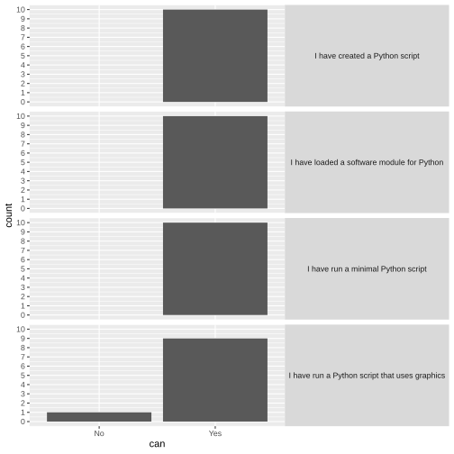
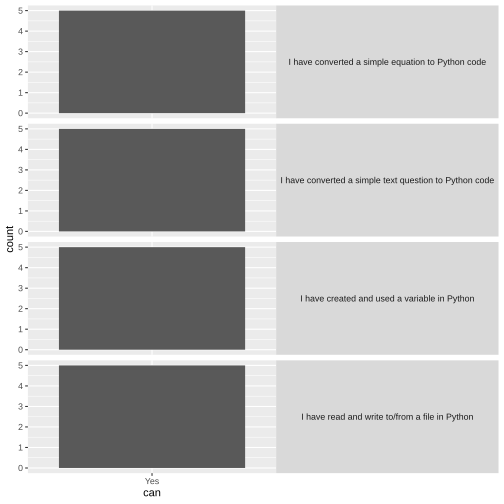

# Evaluation

- Date: 2026-11-16
- [Lesson plan](../../lesson_plans/20261116/README.md)
- [Evaluation](../../evaluations/20261116/README.md)
- [Reflection](../../reflections/20261116/README.md)

## Data

- Morning results: [`morning.csv`](morning.csv)
- Afternoon results: [`afternoon.csv`](afternoon.csv)
- Analysis script: [`analyse.R`](analyse.R)

## [Morning feedback](morning_feedback.txt)

- I really like your teaching style!
- Good intro!
- It may be useful to explain how to use the uppmax documentation better so that students can learn to search for answers themselves.

## [Afternoon feedback](afternoon_feedback.txt)

- Mycket bra!
