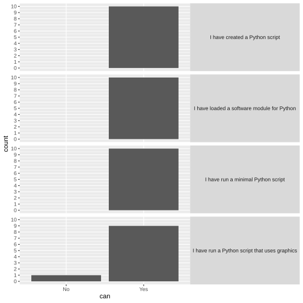
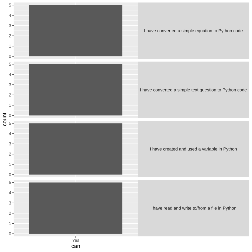

# Reflection

- Date: 2026-11-16
- [Lesson plan](../../lesson_plans/20261116/README.md)
- [Evaluation](../../evaluations/20261116/README.md)
- [Reflection](../../reflections/20261116/README.md)

## Morning

The morning section went smoothly.

I told about myself. I use the algorithm that if I teach 2 hours or more,
I should do so: it feels helpful nowadays; it helps prevent awkward
situations when learners want to 'just listen' or have other bad ideas.

I did Priors as usual. They do take up time and I have read that this time
is worth it, hence I feel at ease with taking that time.
On the other hand, later that day, one learner shared that he/she feels
it shows one down and I shared the same reasoning. What about opening up
the breakout rooms earlier, for that 'just want to work'?
I will try this out!

- [NO] Open breakout rooms earlier

I will not. I am happy that I consider the opinion of my learners, but I
should not over-correct either. I think this learner did fine, by turning
off his/her camera during the Prior.

That went smoothly was noticed by all learners
being done at 11:15:

Time   |Number of learners
-------|------------------
9:30   |15
10:04  |15
~10:30 |8
~11:00 |4
11:15  |0

I am happy with that. If there would be struggling beginners,
I would have had all the
time to help them properly.

I used the strategy to let learners come to the main room when done.
I feel this worked very well.

There is also some time lost on logistic. Unsure how to do this better.
I am sure that not taking this time would result in chaos, so I am
fine doing so.

## Afternoon

This part of the day gets way less love from me,
as I do not like the book and the content is more stable;
the morning session needed some new material on the new Arrhenius
cluster, so this session is always last in the queue to prepare.

Also, I behave differently: I abandoned
the strategy to let learners come to the main room
when done. I think explicitly stating what to do when
done will help me to behave the same.

- [x] Add a 'Done?' part at the end of each session

This should fix the sloppiness, but it does not help
me love the book

- [x] Search for a better Python book

This is what Duck.AI gave me:

Book                                                                           |Pretty|Others
-------------------------------------------------------------------------------|------|---------------------------
[Think Python](https://allendowney.github.io/ThinkPython/index.html)           |Yes   |Starts at very start
[Automate The Boring Stuff With Python](https://automatetheboringstuff.com/3e/)|Very  |Uses 'Mu' editor, best beginning
[Python For Everybody](https://www.py4e.com/book.php)                          |Meh   |Nice start

It recommended the first book most. I agree.

In this part of the day, I had three learners at the end of the day.
I am perfectly happy with that amount.

## Evaluation results

## [Morning feedback](../../evaluations/20261116/morning_feedback.txt)

- I really like your teaching style!

Great!

- Good intro!

Great!

- It may be useful to explain how to use the uppmax documentation better
  so that students can learn to search for answers themselves.

I think this is an interesting comment. I do not show how to search,
as this differs per HPC cluster documentation.
On the other hand, I can show an image where the search box is.
On another hand, I can also **demonstrate** how to search the documentation.

- [->] Demonstrate how to search the documentation

## [Afternoon feedback](../../evaluations/20261116/afternoon_feedback.txt)

- Mycket bra!

Great!

## Reflection after evaluation

There is no critical feedback, so I am done here :-)

I expected the afternoon feedback to be more critical
and was wrong.

## To do next time

- [ ] Try out two input methods for asking a question in the Prior
- [ ] Try out a soft group activity
- [ ] Use [Think Python](https://allendowney.github.io/ThinkPython/index.html)
  as a Python book
- [ ] Demonstrate how to search the documentation
